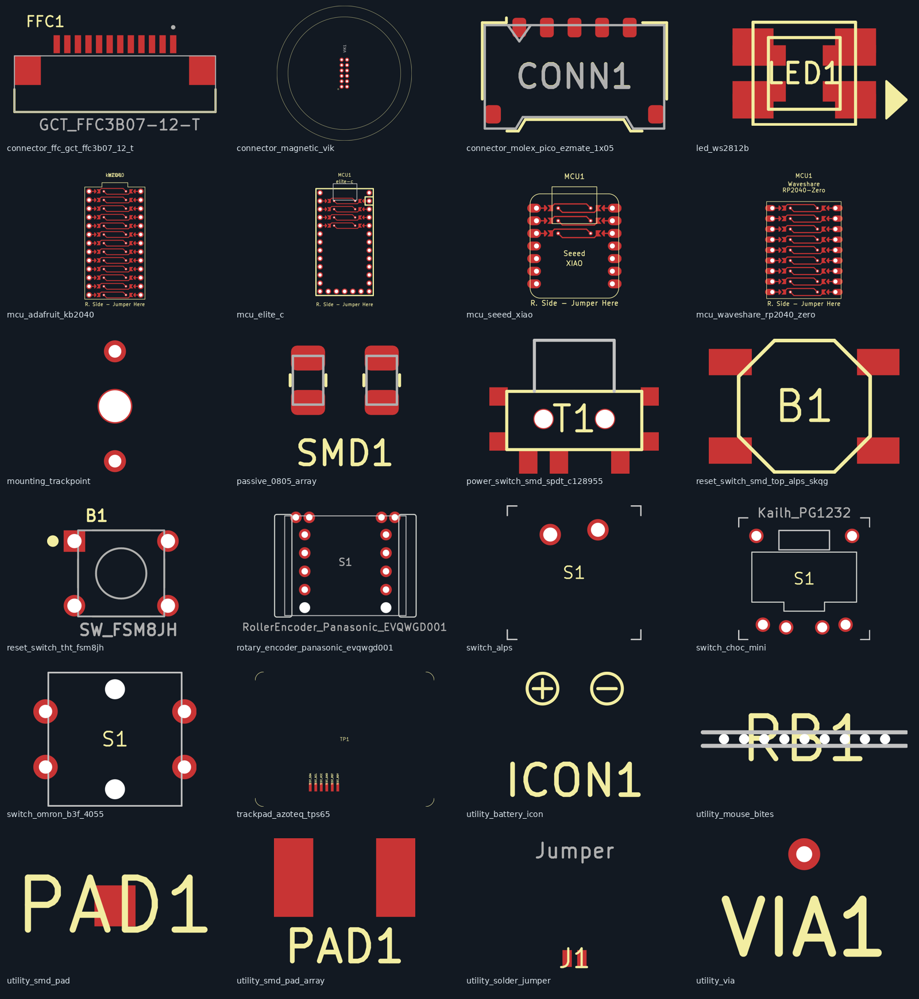

# Legacy Ergogen footprint conversion — 2026-10-25

44 source files were reviewed: 26 from the `backlog` branch and 18 from Ergogen core. The result is **24 new generators**, **9 confirmed duplicate sources**, **10 sources mapped to 8 retained library generators**, and **1 RGB variant incorporated with corrections**. Existing implementations were retained, as requested. “Covered” means component/function coverage, not an identical origin, pad numbering, or parameter API; the exceptions below matter when migrating a board.

[Open the front/back KiCad plot gallery](previews/index.html) · [Source manifest and hashes](manifest.json) · [Validation records](validation.json)



## Source and conversion method

- Backlog: `ceoloide/ergogen-footprints`, commit `96adbfac691d9f3dab418b0a68c838cb3c1f805b`.
- Ergogen: `ergogen/ergogen`, commit `8286e18f18ac064aa6d2ebca9c449bf2f6ba4d37`, `src/footprints`.
- Generated real Ergogen **4.1.0** boards from minimal YAML with a single footprint at **(0, 0, 0°)**, using distinct test nets. Legacy boards use `template: kicad5`; new generators use `template: kicad8`.
- Loaded and saved the legacy boards through **KiCad 9.0.9.1's native `pcbnew.LoadBoard` / `SaveBoard` API**. This uses KiCad's board parser and serializer; no GUI open/save action is claimed.
- Removed UUID, timestamp and edit-time fields after saving. Compared normalized pads, drills, layers, nets and graphics, rather than accepting a successful JavaScript render as proof of conversion.
- Retained the repository's KiCad 8 output dialect. New files use self-contained CommonJS, two-space indentation, semicolons, explicit strokes, quoted layers, Reference properties, named geometry blocks and local helpers for repeated rows.

Of 211 legacy configurations, 210 generated. The original Pro Micro fails with `reversable_pins: 100`; that implementation is retained only as source evidence, with the existing modern MCU used instead. 200 generated boards round-tripped directly. The 10 XIAO cases mixed a legacy board header with modern start/mid/end arcs and crashed the legacy importer. For those cases only, a modern board header and stroke syntax were supplied before native loading, preserving the footprint geometry. All 10 then round-tripped. This preflight repair is recorded separately in [legacy-validation.json](legacy-validation.json).

## Source-by-source disposition

“Duplicate” below was checked using native-normalized geometry, not filenames. In particular, the two files named `button.js` are **different**: the backlog contains a through-hole FSM8JH, while Ergogen core contains an SMD Alps SKQG-style footprint.

| Source | Result | Library generator |
|---|---|---|
| [backlog/infused-kim/conn_molex_pico_ezmate_1x05.js](https://github.com/ceoloide/ergogen-footprints/blob/96adbfac691d9f3dab418b0a68c838cb3c1f805b/backlog/infused-kim/conn_molex_pico_ezmate_1x05.js) | new | [connector_molex_pico_ezmate_1x05.js](../../connector_molex_pico_ezmate_1x05.js) |
| [backlog/infused-kim/icon_bat.js](https://github.com/ceoloide/ergogen-footprints/blob/96adbfac691d9f3dab418b0a68c838cb3c1f805b/backlog/infused-kim/icon_bat.js) | new | [utility_battery_icon.js](../../utility_battery_icon.js) |
| [backlog/infused-kim/pads.js](https://github.com/ceoloide/ergogen-footprints/blob/96adbfac691d9f3dab418b0a68c838cb3c1f805b/backlog/infused-kim/pads.js) | new | [utility_smd_pad_array.js](../../utility_smd_pad_array.js) |
| [backlog/infused-kim/smd_0805.js](https://github.com/ceoloide/ergogen-footprints/blob/96adbfac691d9f3dab418b0a68c838cb3c1f805b/backlog/infused-kim/smd_0805.js) | new | [passive_0805_array.js](../../passive_0805_array.js) |
| [backlog/infused-kim/trackpoint_mount.js](https://github.com/ceoloide/ergogen-footprints/blob/96adbfac691d9f3dab418b0a68c838cb3c1f805b/backlog/infused-kim/trackpoint_mount.js) | new | [mounting_trackpoint.js](../../mounting_trackpoint.js) |
| [backlog/mrzealot/alps.js](https://github.com/ceoloide/ergogen-footprints/blob/96adbfac691d9f3dab418b0a68c838cb3c1f805b/backlog/mrzealot/alps.js) | new | [switch_alps.js](../../switch_alps.js) |
| [backlog/mrzealot/button.js](https://github.com/ceoloide/ergogen-footprints/blob/96adbfac691d9f3dab418b0a68c838cb3c1f805b/backlog/mrzealot/button.js) | new | [reset_switch_tht_fsm8jh.js](../../reset_switch_tht_fsm8jh.js) |
| [backlog/mrzealot/chocmini.js](https://github.com/ceoloide/ergogen-footprints/blob/96adbfac691d9f3dab418b0a68c838cb3c1f805b/backlog/mrzealot/chocmini.js) | new | [switch_choc_mini.js](../../switch_choc_mini.js) |
| [backlog/mrzealot/jumper.js](https://github.com/ceoloide/ergogen-footprints/blob/96adbfac691d9f3dab418b0a68c838cb3c1f805b/backlog/mrzealot/jumper.js) | new | [utility_solder_jumper.js](../../utility_solder_jumper.js) |
| [backlog/mrzealot/omron.js](https://github.com/ceoloide/ergogen-footprints/blob/96adbfac691d9f3dab418b0a68c838cb3c1f805b/backlog/mrzealot/omron.js) | new | [switch_omron_b3f_4055.js](../../switch_omron_b3f_4055.js) |
| [backlog/mrzealot/pad.js](https://github.com/ceoloide/ergogen-footprints/blob/96adbfac691d9f3dab418b0a68c838cb3c1f805b/backlog/mrzealot/pad.js) | new | [utility_smd_pad.js](../../utility_smd_pad.js) |
| [backlog/mrzealot/rgb.js](https://github.com/ceoloide/ergogen-footprints/blob/96adbfac691d9f3dab418b0a68c838cb3c1f805b/backlog/mrzealot/rgb.js) | new | [led_ws2812b.js](../../led_ws2812b.js) |
| [backlog/mrzealot/scrollwheel.js](https://github.com/ceoloide/ergogen-footprints/blob/96adbfac691d9f3dab418b0a68c838cb3c1f805b/backlog/mrzealot/scrollwheel.js) | new | [rotary_encoder_panasonic_evqwgd001.js](../../rotary_encoder_panasonic_evqwgd001.js) |
| [backlog/mrzealot/slider.js](https://github.com/ceoloide/ergogen-footprints/blob/96adbfac691d9f3dab418b0a68c838cb3c1f805b/backlog/mrzealot/slider.js) | new | [power_switch_smd_spdt_c128955.js](../../power_switch_smd_spdt_c128955.js) |
| [backlog/mrzealot/via.js](https://github.com/ceoloide/ergogen-footprints/blob/96adbfac691d9f3dab418b0a68c838cb3c1f805b/backlog/mrzealot/via.js) | new | [utility_via.js](../../utility_via.js) |
| [backlog/tildewill/azoteq_trackpad.js](https://github.com/ceoloide/ergogen-footprints/blob/96adbfac691d9f3dab418b0a68c838cb3c1f805b/backlog/tildewill/azoteq_trackpad.js) | new | [trackpad_azoteq_tps65.js](../../trackpad_azoteq_tps65.js) |
| [backlog/tildewill/connector_ffc_12p.js](https://github.com/ceoloide/ergogen-footprints/blob/96adbfac691d9f3dab418b0a68c838cb3c1f805b/backlog/tildewill/connector_ffc_12p.js) | new | [connector_ffc_gct_ffc3b07_12_t.js](../../connector_ffc_gct_ffc3b07_12_t.js) |
| [backlog/tildewill/magnetic_vik_keyboard_connector.js](https://github.com/ceoloide/ergogen-footprints/blob/96adbfac691d9f3dab418b0a68c838cb3c1f805b/backlog/tildewill/magnetic_vik_keyboard_connector.js) | new | [connector_magnetic_vik.js](../../connector_magnetic_vik.js) |
| [backlog/tildewill/rat_bite.js](https://github.com/ceoloide/ergogen-footprints/blob/96adbfac691d9f3dab418b0a68c838cb3c1f805b/backlog/tildewill/rat_bite.js) | new | [utility_mouse_bites.js](../../utility_mouse_bites.js) |
| [backlog/virginia2244/elite_c.js](https://github.com/ceoloide/ergogen-footprints/blob/96adbfac691d9f3dab418b0a68c838cb3c1f805b/backlog/virginia2244/elite_c.js) | new | [mcu_elite_c.js](../../mcu_elite_c.js) |
| [backlog/virginia2244/kb2040.js](https://github.com/ceoloide/ergogen-footprints/blob/96adbfac691d9f3dab418b0a68c838cb3c1f805b/backlog/virginia2244/kb2040.js) | new | [mcu_adafruit_kb2040.js](../../mcu_adafruit_kb2040.js) |
| [backlog/virginia2244/nice_nano.js](https://github.com/ceoloide/ergogen-footprints/blob/96adbfac691d9f3dab418b0a68c838cb3c1f805b/backlog/virginia2244/nice_nano.js) | covered | [mcu_nice_nano.js](../../mcu_nice_nano.js) |
| [backlog/virginia2244/pro_micro.js](https://github.com/ceoloide/ergogen-footprints/blob/96adbfac691d9f3dab418b0a68c838cb3c1f805b/backlog/virginia2244/pro_micro.js) | covered | [mcu_nice_nano.js](../../mcu_nice_nano.js) |
| [backlog/virginia2244/rgb.js](https://github.com/ceoloide/ergogen-footprints/blob/96adbfac691d9f3dab418b0a68c838cb3c1f805b/backlog/virginia2244/rgb.js) | variant | [led_ws2812b.js](../../led_ws2812b.js) |
| [backlog/virginia2244/seeed_xiao.js](https://github.com/ceoloide/ergogen-footprints/blob/96adbfac691d9f3dab418b0a68c838cb3c1f805b/backlog/virginia2244/seeed_xiao.js) | new | [mcu_seeed_xiao.js](../../mcu_seeed_xiao.js) |
| [backlog/virginia2244/waveshare_rp2040_zero.js](https://github.com/ceoloide/ergogen-footprints/blob/96adbfac691d9f3dab418b0a68c838cb3c1f805b/backlog/virginia2244/waveshare_rp2040_zero.js) | new | [mcu_waveshare_rp2040_zero.js](../../mcu_waveshare_rp2040_zero.js) |
| [ergogen/src/footprints/alps.js](https://github.com/ergogen/ergogen/blob/8286e18f18ac064aa6d2ebca9c449bf2f6ba4d37/src/footprints/alps.js) | duplicate | [switch_alps.js](../../switch_alps.js) |
| [ergogen/src/footprints/button.js](https://github.com/ergogen/ergogen/blob/8286e18f18ac064aa6d2ebca9c449bf2f6ba4d37/src/footprints/button.js) | new | [reset_switch_smd_top_alps_skqg.js](../../reset_switch_smd_top_alps_skqg.js) |
| [ergogen/src/footprints/choc.js](https://github.com/ergogen/ergogen/blob/8286e18f18ac064aa6d2ebca9c449bf2f6ba4d37/src/footprints/choc.js) | covered | [switch_choc_v1_v2.js](../../switch_choc_v1_v2.js) |
| [ergogen/src/footprints/chocmini.js](https://github.com/ergogen/ergogen/blob/8286e18f18ac064aa6d2ebca9c449bf2f6ba4d37/src/footprints/chocmini.js) | duplicate | [switch_choc_mini.js](../../switch_choc_mini.js) |
| [ergogen/src/footprints/diode.js](https://github.com/ergogen/ergogen/blob/8286e18f18ac064aa6d2ebca9c449bf2f6ba4d37/src/footprints/diode.js) | covered | [diode_tht_sod123.js](../../diode_tht_sod123.js) |
| [ergogen/src/footprints/jstph.js](https://github.com/ergogen/ergogen/blob/8286e18f18ac064aa6d2ebca9c449bf2f6ba4d37/src/footprints/jstph.js) | covered | [battery_connector_jst_ph_2.js](../../battery_connector_jst_ph_2.js) |
| [ergogen/src/footprints/jumper.js](https://github.com/ergogen/ergogen/blob/8286e18f18ac064aa6d2ebca9c449bf2f6ba4d37/src/footprints/jumper.js) | duplicate | [utility_solder_jumper.js](../../utility_solder_jumper.js) |
| [ergogen/src/footprints/mx.js](https://github.com/ergogen/ergogen/blob/8286e18f18ac064aa6d2ebca9c449bf2f6ba4d37/src/footprints/mx.js) | covered | [switch_mx.js](../../switch_mx.js) |
| [ergogen/src/footprints/oled.js](https://github.com/ergogen/ergogen/blob/8286e18f18ac064aa6d2ebca9c449bf2f6ba4d37/src/footprints/oled.js) | covered | [display_ssd1306.js](../../display_ssd1306.js) |
| [ergogen/src/footprints/omron.js](https://github.com/ergogen/ergogen/blob/8286e18f18ac064aa6d2ebca9c449bf2f6ba4d37/src/footprints/omron.js) | duplicate | [switch_omron_b3f_4055.js](../../switch_omron_b3f_4055.js) |
| [ergogen/src/footprints/pad.js](https://github.com/ergogen/ergogen/blob/8286e18f18ac064aa6d2ebca9c449bf2f6ba4d37/src/footprints/pad.js) | duplicate | [utility_smd_pad.js](../../utility_smd_pad.js) |
| [ergogen/src/footprints/promicro.js](https://github.com/ergogen/ergogen/blob/8286e18f18ac064aa6d2ebca9c449bf2f6ba4d37/src/footprints/promicro.js) | covered | [mcu_nice_nano.js](../../mcu_nice_nano.js) |
| [ergogen/src/footprints/rgb.js](https://github.com/ergogen/ergogen/blob/8286e18f18ac064aa6d2ebca9c449bf2f6ba4d37/src/footprints/rgb.js) | duplicate | [led_ws2812b.js](../../led_ws2812b.js) |
| [ergogen/src/footprints/rotary.js](https://github.com/ergogen/ergogen/blob/8286e18f18ac064aa6d2ebca9c449bf2f6ba4d37/src/footprints/rotary.js) | covered | [rotary_encoder_ec11_ec12.js](../../rotary_encoder_ec11_ec12.js) |
| [ergogen/src/footprints/scrollwheel.js](https://github.com/ergogen/ergogen/blob/8286e18f18ac064aa6d2ebca9c449bf2f6ba4d37/src/footprints/scrollwheel.js) | duplicate | [rotary_encoder_panasonic_evqwgd001.js](../../rotary_encoder_panasonic_evqwgd001.js) |
| [ergogen/src/footprints/slider.js](https://github.com/ergogen/ergogen/blob/8286e18f18ac064aa6d2ebca9c449bf2f6ba4d37/src/footprints/slider.js) | duplicate | [power_switch_smd_spdt_c128955.js](../../power_switch_smd_spdt_c128955.js) |
| [ergogen/src/footprints/trrs.js](https://github.com/ergogen/ergogen/blob/8286e18f18ac064aa6d2ebca9c449bf2f6ba4d37/src/footprints/trrs.js) | covered | [trrs_pj320a.js](../../trrs_pj320a.js) |
| [ergogen/src/footprints/via.js](https://github.com/ergogen/ergogen/blob/8286e18f18ac064aa6d2ebca9c449bf2f6ba4d37/src/footprints/via.js) | duplicate | [utility_via.js](../../utility_via.js) |

## Retained implementations: coverage and migration

Forty fixtures exercised the eight retained generators: defaults, legacy-relevant features, back placement, reversibility, and a rotated reversible placement. All 40 generated and loaded in KiCad 9. [Coverage records](coverage.json) include parameters, pad counts and populated nets. This is a coverage check, not a full revalidation or rewrite of those existing files.

| Legacy family | Existing coverage | Migration details / gaps |
|---|---|---|
| MX | `switch_mx` | Use `solder: true, hotswap: false` for the legacy solder-only mode. `reverse` → `reversible`; `keycaps` → `include_keycap`. Current hotswap geometry/options are retained. |
| Choc | `switch_choc_v1_v2` | Use `solder: true, hotswap: false, choc_v2_support: false` for the original Choc v1 role. Check the configurable center/stabilizer holes and keycap dimensions rather than assuming identical defaults. |
| Diode | `diode_tht_sod123` | `include_tht: true` provides the legacy THT plus SOD-123 role; `from` and `to` remain the circuit nets. |
| JST PH-2 | `battery_connector_jst_ph_2` | Same 2 mm pin pitch / 0.75 mm drills; current copper height is 1.75 mm versus 1.7 mm. **Legacy front pad 1 at x=-1 used `pos`; current front pad 1 uses `BAT_N`.** Logical names become `BAT_P`/`BAT_N`, but a blind parameter rename changes the net at that hole. Check cable polarity and mounting orientation. |
| OLED | `display_ssd1306` | Covers the four 2.54 mm-pitch SDA/SCL/VCC/GND contacts and adds reversible jumpers. The old vertical pin row at x=1.6 mm and the current horizontal row have different origins/orientations. Re-place the footprint. |
| Rotary | `rotary_encoder_ec11_ec12` | Covers encoder plus push switch. Old `C` is the center/common contact; current `B` is common. Old `from`/`to` become `S1`/`S2`. Aligning the source geometry requires rotating/repositioning; under the -90° alignment the old A/B/C correspond to current C/A/B. Current contact holes are slots and mounting dimensions are configurable, so this is not an exact land-pattern replacement. |
| TRRS | `trrs_pj320a` | Legacy A/B/C/D map by contact position to R1/TP/R2/SL. `reverse` → `reversible`; symmetric mode remains available. Current pad numbering follows the connector roles rather than the old 1–4 numbering. |
| Pro Micro | `mcu_nice_nano` | Standard 24-contact header role is covered. Preserve P0…P21 and supply nets; choose `reverse_mount`, `side` and `only_required_jumpers` for the intended assembly. The old `orientation` and `reversable_pins` APIs are not aliases. |
| nice!nano | `mcu_nice_nano` | Standard headers and the three extra GPIO contacts are covered (`include_extra_pins: true` in supported modes). **The backlog's additional BNEG/BPOS row is not reproduced**; its 29-pad non-reversible layout differs from the current 27-pad layout with extra GPIOs. Keep the current implementation and route battery connections through the intended RAW/GND connections or a separate connector. |

The nice!nano GPIO aliases are: P006→P1, P008→P0, P017→P2, P020→P3, P022→P4, P024→P5, P100→P6, P011→P7, P104→P8, P106→P9, P031→P21, P029→P20, P002→P19, P115→P18, P113→P15, P111→P14, P010→P16 and P009→P10. P101/P102/P107 retain their names. Battery pad aliases do not create the missing physical battery row.

## Deliberate changes in the new generators

- `reverse` / `reversable` → `reversible`, default **false**. `reversable_pins` → numeric `reversible_rows`, clamped to available rows. MCU `label`, `instructions` and `traces` become `include_labels`, `include_instructions` and `include_traces`. `keycaps` becomes `include_keycap`.
- Arrays use `mirror_back` because `mirror` is an Ergogen configuration key. Fixed the undeclared pad counter, capped array counts, corrected `net_6`'s accidental `PAD_5` default, and kept each mirrored pad number associated with the same net. Label strings are escaped.
- The standalone pad uses `side` and `reversible` instead of independent `front` / `back` switches; it now defaults to the front only. Separate SMD faces are not automatically connected.
- Removed ignored `side` options from Choc Mini and magnetic VIK, and ignored MCU `view` options. Fixed generated references and visibility, including back-only Molex/battery-icon placements. Added explicit placement angles and mirrored side-selected text.
- TPS65 back placement mirrors the hotbar contacts and outline correctly. WS2812B back pads mirror physical pin identity. The Virginia RGB variant's same-position back pads and connecting holes were not copied: with a physically mirrored part they would connect different pins. Reversible LED faces now require explicit board routing.
- Omron B3F-4055's four electrical terminals were incorrectly NPTH, causing KiCad to discard their nets. They are now plated, with the original 1.2 mm drills and positions; `pad_size: 2.2` gives a 0.5 mm radial annulus. This copper diameter is an explicit conversion choice. The two locating bosses remain NPTH. [Omron drawing](https://omronfs.omron.com/en_US/ecb/products/pdf/en-b3f.pdf).
- MCU traces use `p.eaxy()` and explicit net IDs. Jumper destination pads have distinct numbers from isolated socket pads. Elite-C's common VBUS row no longer gets a conflicting local-net jumper bank, and all selected remaining rows receive matching pads and routing. RP2040-Zero retains the original omission of its five bottom contacts in reversible mode; Elite-C bottom GPIO contacts retain their fixed mapping.
- Corrected copied RP2040-Zero “Seeed / XIAO” silkscreen labels. Moved new MCU references away from the jumper routing, and moved XIAO/RP2040-Zero name labels to avoid overlap with the routing/reference.

For all 24 new default configurations, native-normalized **non-text graphics match the source**. Pads, copper dimensions, drills, layers and nets match for **23/24**; the four Omron electrical pads are the documented exception. These comparisons use equivalent non-reversible source settings, not legacy reversible defaults. See [pad comparison](pad-comparison.json) and [graphics comparison](graphics-comparison.json). This does not certify the original mechanical design against a physical component.

## Validation and remaining source issues

- **24 JavaScript syntax checks**.
- **199 actual Ergogen configurations**, including front/back, each boolean, combined flags, array limits, all/no jumper rows, and translated 90° / 27° placements.
- All **199 load in KiCad 8.0.9 and KiCad 9.0.9.1**; KiCad 9 saves were normalized for comparison.
- **5,494 assertions**, zero failures: generated references, explicit track nets, pad-number/net consistency, and pad/trace rotation and translation.
- **1,080 routed components checked**, all reaching at least two pad centers on their intended net. This checks internal routing; it does not assume the open solder jumpers have been bridged.
- **61 KiCad DRC runs** covering each new default, each reversible mode and translated oblique placement. [DRC summary](drc-summary.json).
- **48 native KiCad SVG plots** (front/back); the front contact sheet was visually inspected. These are plots of isolated footprint boards, not screenshots of a GUI or manufacturing approval.

**Panasonic EVQWGD001 reversible mode retains two copper-to-cutout clearance violations at S1.** The second wheel cutout approaches the mirrored switch terminal. The holes and cutouts are source geometry, so their positions were not silently changed. That reversible mode needs a mechanical redesign before fabrication; the default single-sided pattern does not produce these violations.

The DRC runs also report inherited silkscreen/copper overlaps, some text overlaps, and the TPS65's 0.6 mm label height. References were deliberately visible in the test boards, so reference-on-pad warnings are included. These are listed rather than suppressed. Isolated boards generally have no outer board outline, and the generators are not installed in a KiCad `.pretty` library, so `invalid_outline` and `lib_footprint_issues` are fixture/library-context findings. The records are **not a claim of zero DRC violations**. No fabrication or physical-fit test was performed.

## Example

Place this as `config.yaml` beside a `footprints/ceoloide` checkout of this library and run Ergogen on the containing directory:

```yaml
meta:
  engine: 4.1.0
points:
  zones:
    origin:
      anchor:
        shift: [0, 0]
      columns:
        only:
      rows:
        only:
pcbs:
  test:
    template: kicad8
    references: true
    footprints:
      switch:
        what: ceoloide/switch_alps
        where: true
        params:
          from: COL0
          to: ROW0
```

Each new file documents its own pin mapping, defaults, dimensions and assembly limitations. The footprint's KiCad library identifier uses `ceoloide:<filename>`; Ergogen's folder lookup uses `ceoloide/<filename>`.

## Reproduce the new-generator checks

The scripts use the installed Ergogen package and native KiCad Python module; they do not add runtime dependencies to footprint files. Run from this repository, giving an absolute path to a `node_modules` directory containing Ergogen 4.1.0 and js-yaml:

```sh
node research/legacy-footprint-conversion-2026-10-25/scripts/generate.js /path/to/node_modules /tmp/footprint-check
/path/to/kicad9/python3 research/legacy-footprint-conversion-2026-10-25/scripts/roundtrip.py /tmp/footprint-check
python3 research/legacy-footprint-conversion-2026-10-25/scripts/verify.py /tmp/footprint-check
```

The generator saves every YAML fixture and raw board under the chosen temporary directory; the round-trip script saves native and UUID-stripped boards plus parsed validation metadata. Repeat the round-trip script with KiCad 8's Python to check compatibility. `baseline.js` accepts a working directory containing `backlog/` and `ergogen/src/footprints/` from the pinned revisions, then the runtime `node_modules` path, to reproduce the legacy generation matrix.

## Attribution

The five @infused-kim derivatives retain [**CC-BY-NC-SA-4.0**](https://creativecommons.org/licenses/by-nc-sa/4.0/). The other backlog derivatives retain their original **MIT** headers and author attribution. The core Alps-button conversion retains Ergogen's **2018 Bán Dénes / MIT** attribution; its full notice is included in [licenses/ergogen-MIT.txt](licenses/ergogen-MIT.txt). Per-file source hashes, commit links and licenses are in the manifest. No Altium files are involved.
